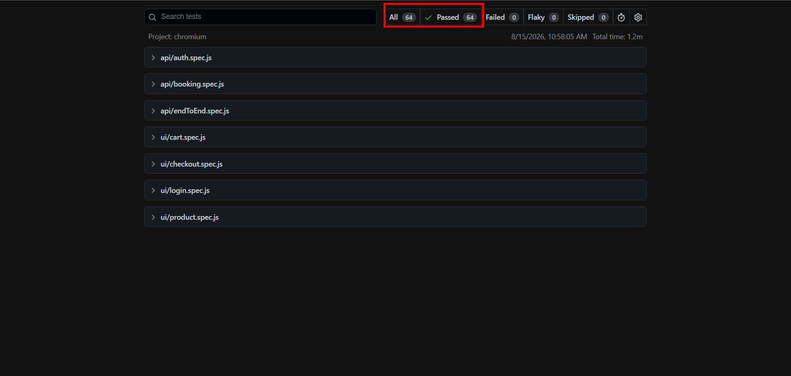
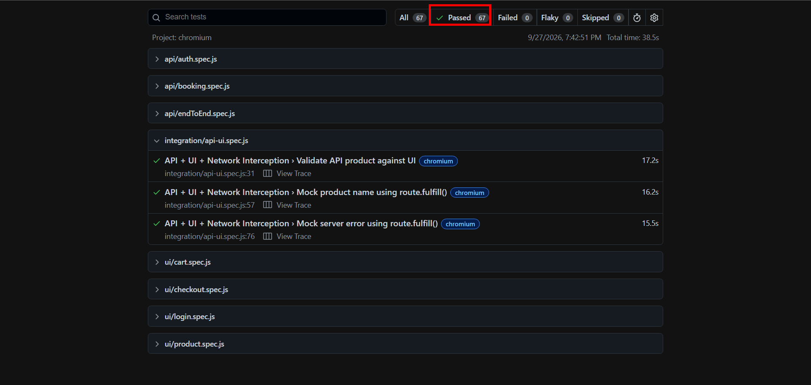

# Playwright E-Commerce Automation Framework

A Playwright automation framework built with TypeScript for UI automation, REST API testing, API–UI integration testing, data-driven testing, network interception, and Docker-based CI/CD execution using GitHub Actions.

The project initially started as a JavaScript-based Playwright UI automation framework for SauceDemo. It was subsequently migrated to TypeScript and expanded to cover multiple testing layers, reusable framework components, static type-checking, containerized test execution, and automated CI/CD workflows.

The objective is to demonstrate how a maintainable automation framework can be structured using Page Object Model (POM), reusable fixtures, API client abstractions, centralized test data, Docker, and GitHub Actions.

## Key Features

- Playwright UI automation using TypeScript
- JavaScript-to-TypeScript framework migration
- Page Object Model (POM)
- Reusable custom fixtures
- REST API automation using Playwright APIRequestContext
- API authentication and CRUD operations
- Data-driven positive and negative testing
- API–UI integration testing
- Network interception and response mocking
- TypeScript static type-checking
- Docker-based test execution
- GitHub Actions CI/CD
- Docker Buildx layer caching
- Playwright HTML reports and CI test artifacts
- Environment-specific configuration

## What This Project Covers

### 1. UI Automation

The framework automates e-commerce workflows on SauceDemo.

Test coverage includes:

- Login functionality
- Product listing and sorting
- Product details validation
- Cart operations
- Checkout workflows
- Negative validation scenarios

UI tests are organized by feature to keep test cases maintainable and easy to navigate.

### 2. REST API Automation

The framework uses the Restful Booker API to validate backend behavior independently of the UI.

Test coverage includes:

- Authentication
- Create Booking
- Retrieve Booking
- Update Booking
- Partial Update
- Delete Booking
- End-to-end CRUD workflow

API requests are encapsulated in reusable API client classes instead of being duplicated across test specifications.

### 3. Data-Driven Testing (DDT)

Negative test scenarios use reusable test data maintained separately from the test logic.

Examples include:

- Invalid authentication scenarios
- Negative booking payloads
- Invalid checkout inputs

This approach improves maintainability and makes it easier to add scenarios without duplicating test code.

### 4. API–UI Integration Testing

The framework includes an integration scenario that creates data through an API request and then validates the resulting data through the UI.

This approach demonstrates how API operations can be used to prepare test data and how the UI can validate the resulting application behavior.

The integration test is maintained separately under `tests/integration`.

### 5. Network Interception and Mocking

Playwright route interception is used to modify API responses before they reach the browser.

Example scenario:

1. Intercept a product API response.
2. Replace a product name with a mocked value.
3. Verify that the UI displays the mocked product data.

This allows frontend behavior to be tested against controlled responses without depending entirely on backend data.

### 6. JavaScript to TypeScript Migration

The framework was initially developed using JavaScript and subsequently migrated to TypeScript.

The migration established a TypeScript-based structure across the framework, including page objects, API clients, custom fixtures, test data, utility functions, test specifications, and Playwright configuration.

Key improvements include:

- TypeScript classes for UI page objects and API clients
- Typed reusable fixtures and test dependencies
- Type-safe test data and utility functions
- Static type-checking using `tsc --noEmit`
- Type-checking as a dedicated job in GitHub Actions
- Improved maintainability through compile-time type validation

The framework uses TypeScript for static analysis while Playwright executes the tests through its supported TypeScript test runner.

## Framework Architecture

```text
playwright-ecommerce-framework/
│
├── pages/
│   ├── ui/
│   │   ├── BasePage.ts
│   │   ├── LoginPage.ts
│   │   ├── ProductPage.ts
│   │   ├── CartPage.ts
│   │   └── CheckoutPage.ts
│   │
│   └── api/
│       ├── BaseAPI.ts
│       ├── AuthAPI.ts
│       └── BookingAPI.ts
│
├── fixtures/
│   └── fixtures.ts
│
├── test-data/
│   ├── auth.ts
│   ├── checkoutNegative.ts
│   ├── createBookingNegative.ts
│   ├── headers.ts
│   ├── loginNegative.ts
│   ├── payload.ts
│   └── users.ts
│
├── tests/
│   ├── ui/
│   │   ├── login.spec.ts
│   │   ├── product.spec.ts
│   │   ├── cart.spec.ts
│   │   └── checkout.spec.ts
│   │
│   ├── api/
│   │   ├── auth.spec.ts
│   │   ├── booking.spec.ts
│   │   └── endToEnd.spec.ts
│   │
│   └── integration/
│       └── api-ui.spec.ts
│
├── utils/
│   └── assertions.ts
│
├── screenshots/
│   ├── playwright-report.png
│   └── playwright-report_Integration.png
│
├── .github/
│   └── workflows/
│       └── playwright.yml
│
├── .dockerignore
├── .gitignore
├── Dockerfile
├── package.json
├── package-lock.json
├── playwright.config.ts
├── tsconfig.json
└── README.md
```

## Framework Design

### Page Object Model (POM)

UI interactions are encapsulated in dedicated page classes. This separates page-specific behavior from test logic and reduces duplication across UI tests.

### API Client Abstraction

API requests are organized into reusable classes:

- `BaseAPI.ts`
- `AuthAPI.ts`
- `BookingAPI.ts`

This separates API communication from test assertions and provides reusable methods for backend validation.

### Custom Fixtures

The shared fixture implementation in `fixtures/fixtures.ts` provides reusable test dependencies, including page objects, API clients, authentication tokens, and common headers.

This keeps test specifications focused on the scenario being validated rather than repeatedly implementing setup logic.

### Centralized Test Data

Reusable payloads, authentication data, headers, user data, and negative scenarios are maintained under `test-data/`.

This separation improves test readability and supports data-driven test execution.

### TypeScript Type-Checking

The framework uses TypeScript static type-checking to identify type-related errors before executing the test suites.

Run the check with:

```bash
npm run typecheck
```

This command runs `tsc --noEmit`, which checks the TypeScript code without generating JavaScript output.

## Docker Integration

The framework supports containerized Playwright test execution using the official Playwright Docker image.

Docker provides a consistent runtime environment and reduces dependence on locally installed browser binaries and operating-system libraries.

### Dockerfile

The Dockerfile uses:

```dockerfile
FROM mcr.microsoft.com/playwright:v1.61.1-noble

WORKDIR /app

COPY package*.json ./

RUN npm ci

COPY . .

CMD ["npx", "playwright", "test"]
```

The image:

1. Uses the Playwright `v1.61.1-noble` base image.
2. Sets `/app` as the working directory.
3. Copies package manifests into the image.
4. Installs dependencies using `npm ci`.
5. Copies the framework into the image.
6. Executes the default Playwright test command when the container starts.

### Docker Ignore Configuration

The `.dockerignore` file excludes selected files and directories from the Docker build context:

- `node_modules`
- `playwright-report`
- `test-results`
- `.git`
- `.env`

Environment-specific files such as `.env.test` should also be excluded from the Docker build context if they contain credentials.

### Build the Docker Image

Prerequisites: Docker Desktop or Docker Engine must be installed and running.

From the repository root:

```bash
docker build -t playwright-ecommerce .
```

### Run the Default Test Suite

```bash
docker run --rm playwright-ecommerce
```

The container executes the default Playwright test command configured in the Dockerfile.

### Run UI Tests in Docker

```bash
docker run --rm playwright-ecommerce npx playwright test tests/ui
```

### Run API Tests in Docker

```bash
docker run --rm playwright-ecommerce npx playwright test tests/api
```

### Run Integration Tests in Docker

```bash
docker run --rm playwright-ecommerce npx playwright test tests/integration
```

Integration tests require the appropriate environment configuration and valid account credentials.

### Run TypeScript Type-Checking in Docker

```bash
docker run --rm playwright-ecommerce npm run typecheck
```

### Preserve Test Reports and Results

The Docker container should write reports and test results to mounted host directories when those files need to remain available after the container exits.

For example, on Linux or macOS:

```bash
mkdir -p playwright-report test-results

docker run --rm \
  -v "$PWD/playwright-report:/app/playwright-report" \
  -v "$PWD/test-results:/app/test-results" \
  playwright-ecommerce \
  npx playwright test tests/ui
```

On Windows PowerShell, use `${PWD}` when specifying the current directory in volume paths.

Open the generated HTML report from the host project directory:

```bash
npx playwright show-report
```

## CI/CD with GitHub Actions

The framework uses GitHub Actions to build the Docker image and execute automation jobs inside containers.

The workflow is defined in:

```text
.github/workflows/playwright.yml
```

The workflow supports automatic execution on pushes and manual execution through `workflow_dispatch`.

### Pipeline Architecture

The workflow contains four jobs.

#### 1. Type-Checking

Responsibilities:

- Check out the repository.
- Configure Docker Buildx.
- Build the Docker image.
- Reuse cached Docker image layers where available.
- Run `npm run typecheck` inside the container.

This job validates TypeScript code before the automation suites are considered.

#### 2. UI Tests

Responsibilities:

- Build the Docker image.
- Prepare report and test-result directories.
- Execute UI tests inside Docker.
- Mount report directories to the GitHub Actions runner.
- Upload the Playwright report and test-result artifacts.

Artifact names:

- `ui-playwright-report`
- `ui-test-results`

#### 3. API Tests

Responsibilities:

- Build the Docker image.
- Execute API tests inside Docker.
- Collect Playwright reports and test results.
- Upload the generated artifacts.

Artifact names:

- `api-playwright-report`
- `api-test-results`

#### 4. Integration Tests

Integration tests are conditional and are not executed on ordinary push events.

The job runs only when:

- The workflow is triggered manually through `workflow_dispatch`.
- The repository variable `RUN_SUBSCRIPTION_TESTS` is set to `true`.

The job receives the following configuration through GitHub Actions secrets:

- `API_URL`
- `API_KEY`
- `PROJECT_URL`
- `EMAIL`
- `PASSWORD`

The job then builds the Docker image, executes the integration suite inside the container, and attempts to upload its report and test-result artifacts.

Artifact names:

- `integration-playwright-report`
- `integration-test-results`

The target account must have an active subscription, and the supplied credentials and URLs must correspond to the subscribed project.

### Docker Build Caching

The workflow uses Docker Buildx and the GitHub Actions cache backend.

Separate cache scopes are configured for the type-checking, UI, API, and integration jobs:

- `playwright-typecheck`
- `playwright-ui`
- `playwright-api`
- `playwright-integration`

This allows Docker build layers to be reused across workflow runs when the relevant cache entries remain available.

### Artifact Collection

The workflow uses `if: always()` for report and test-result upload steps, allowing artifact collection to be attempted even when a test job fails.

Artifact uploads are configured with `if-no-files-found: ignore`. Therefore, an artifact may be absent if the corresponding files were not generated.

## Prerequisites

### Local Development

- Node.js
- npm
- Git
- Docker Desktop or Docker Engine for containerized execution

### Integration Testing

- An active subscription for the target project
- A valid project URL
- A valid API URL and API key
- A valid account email and password

## Running Tests Locally

### 1. Install Dependencies

```bash
npm ci
```

### 2. Run TypeScript Type-Checking

```bash
npm run typecheck
```

### 3. Run UI Tests

```bash
npx playwright test tests/ui
```

### 4. Run API Tests

```bash
npx playwright test tests/api
```

### 5. Run Integration Tests

```bash
npx playwright test tests/integration
```

The integration spec requires the following environment variables:

```text
PROJECT_URL
API_URL
API_KEY
EMAIL
PASSWORD
```

The integration spec loads these values from `.env`. Configure the corresponding values in a local environment file before executing the integration tests.

The Playwright configuration separately loads:

```text
.env.${ENV || "test"}
```

When `ENV` is unset, the configuration loads `.env.test`.

Keep credentials out of source control and do not commit files containing real API keys or passwords.

### 6. Run the Default Playwright Suite

```bash
npx playwright test
```

The Playwright configuration excludes files matching `**/api-ui.spec.ts` from normal test discovery.

The default command may include other integration tests present under `tests`, so ensure their environment requirements are satisfied before running the complete suite.

### 7. View the HTML Report

```bash
npx playwright show-report
```

Run this command after test execution has generated a report in the current project directory.

## Environment and Secret Management

The framework uses dotenv for environment-specific configuration.

Best practices:

- Store local credentials in environment files.
- Keep real credentials out of Git.
- Use GitHub Actions repository secrets for CI/CD.
- Avoid hardcoding API keys and passwords in test files.
- Exclude secret-containing environment files from Docker build contexts.
- Review generated reports and artifacts before sharing them publicly.

The current `.dockerignore` excludes `.env`, but does not explicitly exclude `.env.test` or other `.env.*` files. Review and update the ignore rules if these files contain secrets.

## Tech Stack

| Category                     | Technologies                                         |
| ---------------------------- | ---------------------------------------------------- |
| Programming language         | TypeScript, JavaScript (original implementation)     |
| UI automation                | Playwright                                           |
| API automation               | Playwright APIRequestContext                         |
| Framework architecture       | Page Object Model, custom fixtures                   |
| Test design                  | Data-driven testing, positive and negative scenarios |
| Integration testing          | API–UI validation                                    |
| Network testing              | Route interception and response mocking              |
| Static analysis              | TypeScript compiler (`tsc --noEmit`)                 |
| Containerization             | Docker                                               |
| Container build optimization | Docker Buildx, GitHub Actions cache                  |
| CI/CD                        | GitHub Actions                                       |
| Environment configuration    | dotenv                                               |
| Version control              | Git, GitHub                                          |

## Key Learnings

- Migrating an existing Playwright JavaScript framework to TypeScript.
- Structuring UI automation with Page Object Model.
- Building reusable API clients and custom fixtures.
- Implementing data-driven and negative testing.
- Validating consistency between API operations and UI behavior.
- Mocking network responses with Playwright route interception.
- Using TypeScript static type-checking.
- Running automation suites in Docker containers.
- Integrating containerized testing into GitHub Actions.
- Optimizing Docker builds using cached layers.
- Collecting test reports and test-result artifacts.
- Managing environment-specific configuration and credentials.

## Playwright Reports

### UI and API Report



### Integration Report



## Author

**Vignesh K S**

QA Automation Engineer

Playwright | TypeScript | JavaScript | API Testing | Selenium | Docker | GitHub Actions CI/CD
